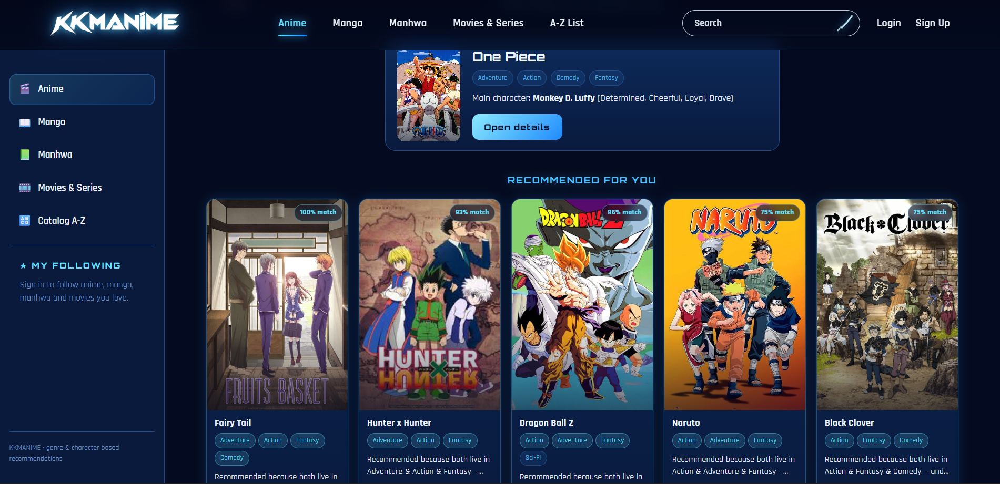
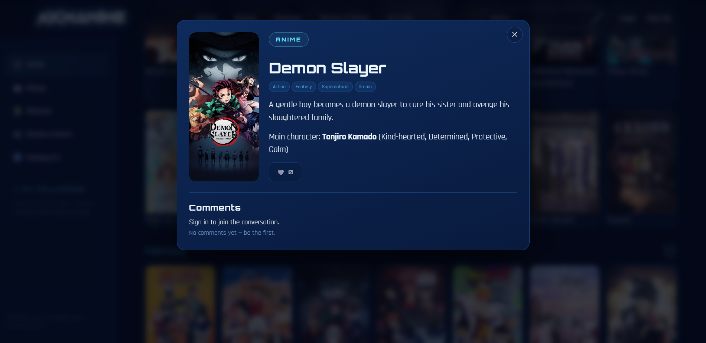
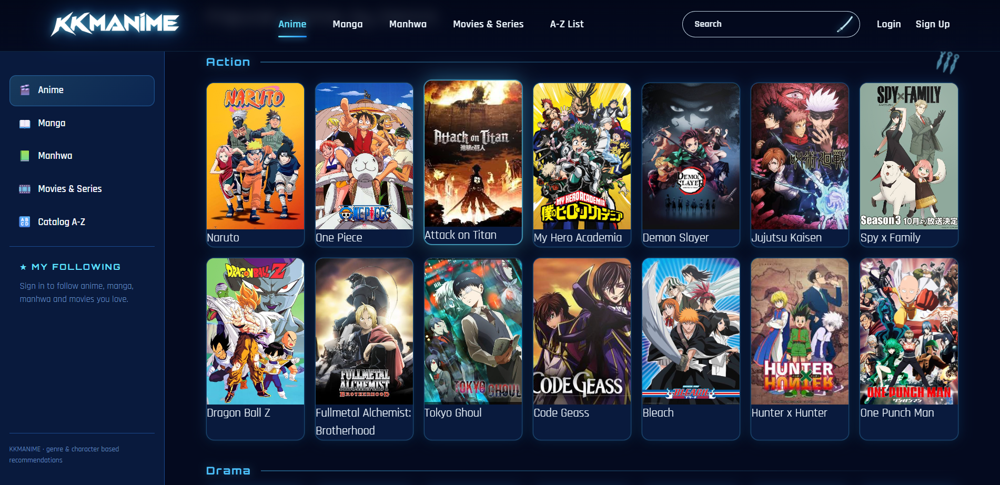
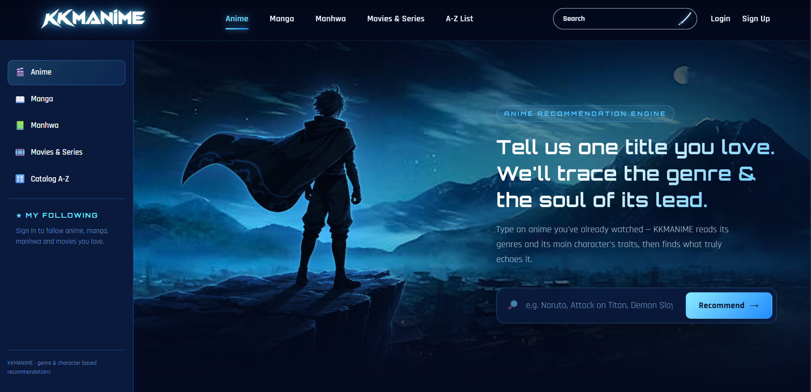

# KKMANIME — Anime Recommendation Platform

> **Discover your next anime through genre and character-based recommendations.**

KKMANIME is a modern anime discovery and recommendation web application built with **React** and **Machine Learning**. Users can enter an anime they already enjoy, and the recommendation engine analyzes its genre profile and main-character traits to surface titles with similar characteristics.

The project combines a responsive anime catalog UI with an ML-powered recommendation workflow, creating a simple experience for discovering what to watch next.

---

## ✨ Features

- 🎯 **ML-powered anime recommendations** based on similarity between anime profiles.
- 🧠 **Genre + character-trait matching** to make recommendations more meaningful than title-only search.
- 🔎 **Anime search and discovery** from a centralized catalog.
- 🗂️ **Genre-based browsing** including Action, Drama, Fantasy, Adventure, Comedy, Sci-Fi, and more.
- 📌 **Recommended For You** section with match percentages.
- 🖼️ **Rich anime cards** with posters, genres, and recommendation explanations.
- 📖 **Anime details modal** containing synopsis, genres, main-character information, and comments.
- ❤️ **Following/favorites-ready UI** for users who want to keep track of titles.
- 🌙 **Dark neon-blue interface** designed around an anime/cyber aesthetic.
- 📱 **Responsive React interface** suitable for desktop and adaptable to smaller screens.

---

## 🧠 How the Recommendation System Works

The core idea is to represent each anime using descriptive features such as:

```text
Anime
 ├── Genres
 │    ├── Action
 │    ├── Adventure
 │    ├── Fantasy
 │    └── Comedy
 │
 └── Main Character Traits
      ├── Brave
      ├── Determined
      ├── Loyal
      └── Cheerful
```

When a user provides a title such as **Naruto**, **Attack on Titan**, or **Demon Slayer**, the system can:

1. Identify the selected anime.
2. Extract or load its genre and character-feature representation.
3. Convert the descriptive attributes into a machine-readable feature vector.
4. Compare the selected anime with other titles using a similarity model.
5. Rank titles by similarity.
6. Display the closest matches with a percentage-style match indicator.
7. Explain the recommendation using overlapping genres and characteristics.

A simplified conceptual pipeline is:

```text
User Input
    ↓
Anime Lookup
    ↓
Feature Extraction
    ↓
Genre + Character Representation
    ↓
ML Similarity Model
    ↓
Similarity Scores
    ↓
Ranked Recommendations
    ↓
React Recommendation Cards
```

> **Note:** The exact model, feature engineering, and similarity algorithm can be changed independently of the React UI. This makes the project suitable for experimenting with different recommendation approaches.

---

## 🛠️ Tech Stack

| Layer | Technology |
|---|---|
| Frontend | React |
| Language | JavaScript |
| Styling | CSS / modern responsive UI |
| Recommendation | Machine Learning |
| ML approach | Feature-based similarity / recommendation modeling |
| UI | Component-based React architecture |
| Data | Anime metadata, genres, and character attributes |

### Frontend

The interface is designed around reusable React components such as:

```text
Navbar
Sidebar
SearchBar
AnimeCard
RecommendationCard
GenreSection
AnimeDetailsModal
RecommendationInput
```

This keeps the UI modular and makes new pages or recommendation features easier to add.

---

# 📸 Screenshots

## 1. Recommendation Dashboard

The main dashboard presents a selected anime, its metadata, and a **Recommended For You** section containing similarity-based suggestions.



The recommendation cards display:

- Match percentage
- Anime poster
- Genres
- Recommendation explanation
- Access to additional details

---

## 2. Anime Details Modal

Selecting an anime opens a focused details view with its poster, genres, description, main character, character traits, and comments section.



This keeps the user inside the application while providing additional information about the selected title.

---

## 3. Genre-Based Anime Catalog

The catalog organizes anime into sections such as **Action** and **Drama**, allowing users to explore the collection even without using the recommendation engine.



Each anime card contains a poster and title, while the genre layout makes browsing quick and visual.

---

## 4. Recommendation Landing Page

The landing experience explains the recommendation concept and lets users enter an anime they already enjoy.



The central flow is intentionally simple:

```text
Enter an anime you love
          ↓
Click Recommend
          ↓
Analyze its profile
          ↓
Receive similar anime
```

---

# 🚀 Getting Started

## Prerequisites

Make sure you have the following installed:

- **Node.js**
- **npm**
- A modern web browser
- Your ML/recommendation service or model environment

## Installation

Clone the repository:

```bash
git clone https://github.com/your-username/kkmanime.git
cd kkmanime
```

Install dependencies:

```bash
npm install
```

Start the development server:

```bash
npm run dev
```

Then open the local development URL shown by your React/Vite setup.

---

# 📁 Suggested Project Structure

```text
KKMANIME/
│
├── public/
│   └── images/
│
├── src/
│   ├── components/
│   │   ├── Navbar.jsx
│   │   ├── Sidebar.jsx
│   │   ├── AnimeCard.jsx
│   │   ├── RecommendationCard.jsx
│   │   └── AnimeDetailsModal.jsx
│   │
│   ├── pages/
│   │   ├── Home.jsx
│   │   ├── Anime.jsx
│   │   └── Recommendations.jsx
│   │
│   ├── data/
│   │   └── animeData.js
│   │
│   ├── services/
│   │   └── recommendationService.js
│   │
│   ├── App.jsx
│   ├── main.jsx
│   └── index.css
│
├── model/
│   ├── preprocessing/
│   ├── recommendation/
│   └── model files
│
├── package.json
└── README.md
```

---

# 🔬 Recommendation Architecture

The ML portion can be separated from the presentation layer:

```text
                 ┌─────────────────────┐
                 │      React UI       │
                 └──────────┬──────────┘
                            │
                            ▼
                 ┌─────────────────────┐
                 │ Recommendation API │
                 └──────────┬──────────┘
                            │
                            ▼
                 ┌─────────────────────┐
                 │ Feature Processing  │
                 └──────────┬──────────┘
                            │
                            ▼
                 ┌─────────────────────┐
                 │ Similarity / ML     │
                 │ Recommendation Model│
                 └──────────┬──────────┘
                            │
                            ▼
                 ┌─────────────────────┐
                 │ Ranked Anime List   │
                 └─────────────────────┘
```

Possible feature representations include:

- One-hot encoded genres
- Multi-label genre vectors
- Character personality attributes
- Text embeddings
- Anime metadata
- Cosine similarity or another distance metric

For example, a simplified feature vector could look like:

```text
Naruto
[Action=1, Adventure=1, Fantasy=1, Comedy=0, Brave=1, Loyal=1]
```

The recommendation model compares this representation against the catalog and returns titles with similar feature profiles.

---

# 🎨 UI & Design

KKMANIME uses a dark visual language with:

- Deep navy backgrounds
- Neon/cyan accents
- Rounded cards
- Glowing borders
- Anime artwork
- High-contrast typography
- Responsive content grids
- Modal-based detail views

The visual style is intended to feel like a modern anime streaming/discovery dashboard rather than a traditional static catalog.

---

# 🔮 Future Improvements

Potential extensions include:

- 🔐 User authentication
- ⭐ Personal ratings and watch history
- ❤️ Persistent favorites/following
- 🎬 Trailer integration
- 📊 Personalized recommendations based on viewing history
- 🧩 Hybrid recommendation using content + collaborative filtering
- 🔥 Trending anime section
- 🏆 Popularity and seasonal rankings
- 🔍 Advanced filters
- 📱 Improved mobile navigation
- ☁️ Cloud deployment
- ⚡ Caching recommendations for faster responses
- 🤖 More advanced embedding-based recommendations

---

# 🤝 Contributing

Contributions are welcome.

```bash
# Fork the project
# Create a feature branch
git checkout -b feature/your-feature

# Commit your changes
git commit -m "Add your feature"

# Push the branch
git push origin feature/your-feature
```

Then open a pull request with a clear description of the changes.

---

# 📄 License

This project is intended as a learning and portfolio project. Add the license of your choice before distributing it publicly.

---

## ⭐ Project Summary

**KKMANIME** brings together **React, machine learning, anime metadata, and a modern UI** to create an interactive anime discovery experience.

Instead of simply showing a static list of titles, the application uses the characteristics of an anime the user already likes to find other titles with similar **genres and character traits**.

> **Tell us one title you love. We'll trace the genre & the soul of its lead.**

